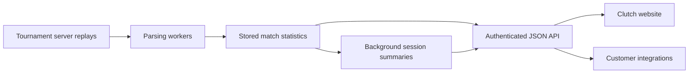

# Clutch Data API

Competitive Fortnite statistics, from tournament replays to match, player and event summaries.

**[Clutch](https://clutchfn.com) · [API documentation](https://clutchfn.com/developers) · [Methodology](https://clutchfn.com/info) · [Data coverage](https://clutchfn.com/status)**

I'm building Clutch as a competitive tracker for players, fans and people building tools around Fortnite tournaments. The website and customer integrations use the same statistics API.

This is the public project overview and example client. The hosted API requires an account API key; cloning this repository does not grant access. The production server, replay parser, databases and trained models are kept outside this repository.

## What I'm working on

- **Replay processing:** turn tournament server replays into stored match and per-player statistics, with live tournament work taking priority.
- **Tournament summaries:** combine saved matches into player totals, stat rankings, weapon summaries and fight statistics.
- **Coverage reporting:** expose which matches are available so partial tournament data can be identified.
- **Expected performance:** estimate placement points from a player's situation and compare actual circle pulls with alternative directions to estimate zone luck.
- **A hosted stats API:** authenticated JSON endpoints, account-level quotas and access to advanced stats by plan.

Zone luck and expected points are model estimates. They have documented limitations and are not guarantees about an individual player's outcome. [How the estimates work](https://clutchfn.com/info).

## How the system fits together



The backend uses Node.js, SQLite and object storage. The web application uses Next.js and TypeScript. Parsing and aggregation run separately from API requests, so a page or stats request can read saved results instead of processing a replay on demand.

Coverage is source-dependent and can be incomplete. Player histories describe stored matches, not every match a player has ever played.

## Try the offline example

Requires Node.js 20 or newer. No packages, API key or network access are needed for the default demo.

```sh
npm run demo
npm test
```

The demo reads [a synthetic response](fixtures/sessions.json) and prints a small coverage summary. Its tournament names and figures are invented examples, not production results.

## Use the example client

For an actual integration, get your own key from your [Clutch account](https://clutchfn.com/account?tab=api). API requests are subject to your plan and consume its request allowance.

```js
import { ClutchClient } from './src/client.mjs';

// Run on your server. Keep the key in an environment variable.
const clutch = new ClutchClient({ apiKey: process.env.CLUTCH_API_KEY });
const result = await clutch.sessions({ limit: 5 });

for (const session of result.sessions) {
  console.log(`${session.title}: ${session.parsed}/${session.matches} matches parsed`);
}
```

The client includes session listing and match-stat requests. It is a small reference integration, not a complete SDK. Production API keys belong on your server, never in browser bundles or committed files.

## API examples

Base URL: `https://clutchfn.com/data-api/v1`

| Endpoint | Purpose |
| --- | --- |
| `GET /sessions` | Stored tournament sessions and parsing counts |
| `GET /sessions/{eventId}/{windowId}/standings` | Tournament standings |
| `GET /sessions/{eventId}/{windowId}/coverage` | Parsing coverage for a session |
| `GET /matches/{matchId}` | Saved match statistics |
| `GET /sessions/{eventId}/{windowId}/luck` | Model-based luck and performance summaries; plan restrictions apply |

The [live documentation](https://clutchfn.com/developers) is the reference for available endpoints, parameters, plans and limits. Customer API access covers statistics; raw replays, movement tracks and website replay viewing are not provided by this example client.

## Repository contents

```text
src/client.mjs         Small server-side API client
examples/demo.mjs      Offline coverage demo
fixtures/sessions.json  Clearly labelled synthetic data
test/client.test.mjs   Request, authentication and error-handling checks
```

This project is in active development. Clutch is not affiliated with Epic Games.
